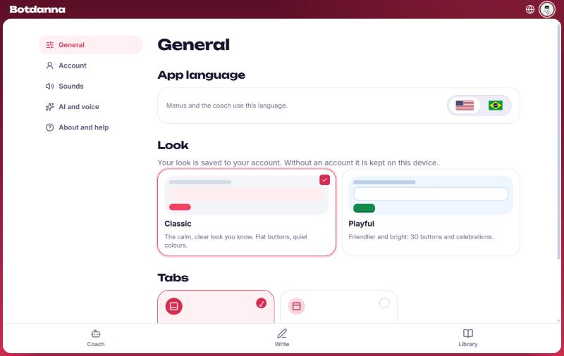
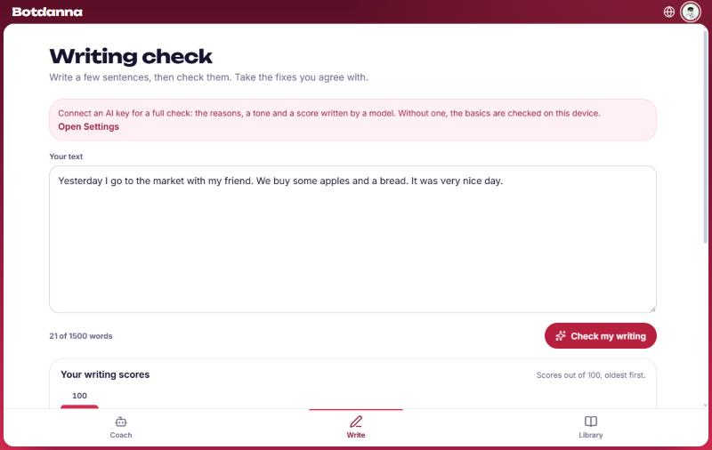

<p align="center">
  
</p>

Botdanna is your AI English coach. Ask it anything about English, practise a real situation with a character, or get your writing checked. It uses your own AI key, and it shares accounts and cloud data with [Danna](https://github.com/emireln/danna), so one sign-in works in both apps.

**[Download for Windows](https://github.com/emireln/botdanna/releases/latest)**. Windows may warn that the app is unsigned: choose *More info*, then *Run anyway*.

<p align="center">
  
  
</p>

## What it does

- **Coach.** Chat about grammar, vocabulary, reading or your own mistakes. Replies can include exercises, feedback cards and words to save.
- **Role-play scenes.** Practise ordering at a café, a job interview or a hotel check-in. Each scene ends with a short summary.
- **Writing check.** Up to 1,500 words, with a score and the reason for each fix.
- **Your files.** Keep PDF, TXT and Markdown files, ask the coach about them, and tap a word while you read.
- **Listen.** Read-aloud with a built-in voice that works offline, a Windows voice, or an OpenAI or Gemini voice with your key.

## Your key and your data

Bring a key from OpenAI, Anthropic, Google Gemini, OpenRouter or DeepSeek. Windows encrypts it on your computer. Each coach reply goes to the provider you chose, with the recent messages, the files you attached and a short summary of your learning. Your name and email are never included.

With an online account, your chats, files and keys (sealed with your password) are kept in the same account Danna uses.

## Run it from source

```bash
npm ci
npm run dev   # the desktop app, with hot reload
npm run web   # the interface in a browser, without AI keys or files
npm test
```

Danna, the English course, lives in [its own repository](https://github.com/emireln/danna). `AGENTS.md` describes the layout for contributors, and `docs/botdanna.md` explains what was kept from Danna.
